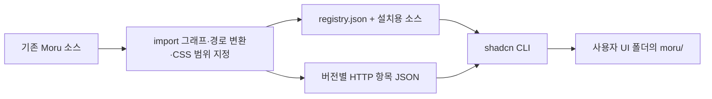

# Moru 레지스트리 구현과 확장 계획

v0.4.0에서 남은 UI 54종을 등록해 갤러리 75종과 StatusMessage의 선택 설치를 모두 제공합니다.
UI 76개·공통 기반 1개·로그인/OTP/검색 필터/설정 폼 블록 4개로 총 81개 설치 항목입니다.
실제 설치와 테마 연결은 [사용 가이드](registry.ko.md)를 참고하세요.
공개 소스는 [syrus-riius/moru-ui](https://github.com/syrus-riius/moru-ui)에 있습니다.

## 원본 하나에서 두 경로로 배포

`scripts/build-registry.mjs`가 실제 import를 AST로 읽고 전용 CSS까지 재귀 수집합니다.
갤러리·스타터·레지스트리를 위해 컴포넌트를 따로 손으로 수정하지 않습니다.
설치용 소스는 `registry/moru/`, HTTP 항목은 `public/r/v0.4.0/`에 생성합니다.
`registry:check`는 소스 체크섬과 생성된 파일 내용이 일치하는지 검사합니다.

## 설치 단위

| 분야 | UI 항목 수 | 대표 항목 |
| --- | ---: | --- |
| 폼·입력 | 25 | `number-input`, `multi-select`, `file-input`, `calendar`, `questionnaire` |
| 버튼·동작 | 5 | `button`, `command`, `button-group`, `kbd`, `toggle` |
| 오버레이 | 9 | `dialog`, `menu`, `tooltip`, `sheet`, `context-menu`, `hover-card` |
| 탐색 | 7 | `tabs`, `menubar`, `navigation-menu`, `sidebar`, `stepper` |
| 레이아웃 | 12 | `card`, `direction`, `carousel`, `resizable`, `scroll-area`, `typography` |
| 상태·피드백 | 10 | `toast`, `alert`, `ring-progress`, `marker`, `status-message` |
| 데이터 | 3 | `table`, `chart`, `data-table` |
| 대화·콘텐츠 | 5 | `bubble`, `code-block`, `message`, `message-scroller`, `trace` |

여기에 `core`와 `login`·`otp`·`search-filters`·`settings` 네 블록을 더해 81개입니다.
전체 설치 이름과 분야별 명령은 [선택 설치 안내](registry.ko.md)에 있습니다.
core는 CSS·토큰·간격·테마·portal·공유 도우미·MIT 고지를 소유하며 컴포넌트는 필요한 스타일을 import합니다.
공유 CSS 8종은 core와 함께 다운로드되지만 core 스타일 진입점이 모두 추가 로드하지는 않습니다.
컴포넌트 JS와 전용 CSS는 실제 의존성에 따라 설치합니다. Chart/Recharts, DataTable/TanStack Table,
Carousel/Embla, Resizable/React Resizable Panels도 선택한 그래프에 포함될 때만 설치합니다.
웹폰트는 자동 다운로드하지 않습니다. 항목 수는 설치 진입점의 수이며 내부 파일·React export 수와 다릅니다.
선택 값은 날짜의 `Date`, `CalendarRange`, 시간의 `HH:mm | null`, `TimeRangeValue`로 나뉩니다.
`calendar-options`·날짜/시간 도우미·필드 context 등은 공개 설치 항목을 따로 늘리지 않고 실제 import 의존성으로 포함합니다.
`direction`의 파일은 `direction-provider.tsx`, `toast`의 공개 API는 `ToastProvider`·`useToast`,
`resizable`의 공개 API는 `ResizablePanelGroup`·`ResizablePanel`·`ResizableHandle`입니다.
공유 도우미의 소유 항목도 의존성이 됩니다. 예를 들어 Menubar는 공유 메뉴 항목 도우미를 제공하는
ContextMenu를 의존성으로 가져옵니다.

## 기존 앱과 함께 사용하기

- 설치 대상은 `@ui/moru/`로 선언해 사용자의 UI 별칭을 따릅니다.
- 원본의 상대 import는 설치 구조에 맞춰 변환하며 `.ts` 확장자 의존성을 제거합니다.
- `MoruProvider`가 해당 영역에만 토큰을 적용합니다. `default.css`의 전역 `:root`는 가져오지 않습니다.
- 공통 CSS는 Moru scope와 portal 내부로 제한하고 animation 이름도 구분합니다.
- 클라이언트 경계가 필요한 생성 파일에는 `use client`를 표시합니다.
- MIT 원문과 재배포 안내를 core의 `_licenses/`에 함께 설치합니다.
- Toast 상태는 앱에서 `MoruProvider` 안에 `ToastProvider`를 배치해 연결합니다.
- DataTable은 Moru의 열 타입과 안정적인 행 ID를, Chart는 설정·데이터 키·제목·표시 높이를 받습니다.
- 설치된 DataTable은 `useEffectEvent`를 사용하므로 현재 기준인 React 19.3을 유지합니다.

## 버전과 의존성

HTTP 의존성은 `https://moru-ui-lab.riius.chatgpt.site/r/v0.4.0/core.json`처럼
버전 경로 전체를 사용합니다. GitHub 의존성도 `syrus-riius/moru-ui/core#v0.4.0`처럼 고정합니다.
단순히 `"button"`을 적으면 shadcn 기본 Button을 가리키므로 Moru 의존성에는 사용하지 않습니다.
새 릴리스는 새 경로와 태그를 발행하며 이전 HTTP 버전 폴더는 유지합니다.
이미 발행한 `public/r/v0.3.1/`·`public/r/v0.3.2/`·`public/r/v0.3.3/`·`public/r/v0.3.4/`는 변경하지 않습니다.
이전 버전 항목의 의존성도 해당 버전으로 고정된 상태를 유지합니다.

## 검증 경로

v0.4.0 추가 범위에는 테스트·설치 스모크·브라우저 점검을 실행하거나 추가하지 않았습니다.
이번 릴리스 작업은 산출물 생성과 프로덕션 빌드로 제한하며 CI 실행도 생략합니다.
아래는 기존 검증 도구의 동작 설명이며 이번 릴리스의 실행 결과를 뜻하지 않습니다.

`npm run registry:smoke`는 실제 shadcn CLI로 독립적인 새 React 프로젝트를 생성합니다.
기본 모드에서는 공개 항목을 임시 localhost에서 제공하며 Moru 의존성의 주소만 local로 변환합니다.
`--base-url https://moru-ui-lab.riius.chatgpt.site/r/v0.4.0` 모드는 배포된 JSON을 그대로 사용합니다.
기존 버튼 보존, 수정한 공통 파일 보존, 별칭·한글·공백 경로, 필요한 의존성만 설치되는지와
TypeScript·프로덕션 빌드를 확인합니다. 화면·키보드·폼 동작은 설치된 소비자 앱에서 별도로 점검합니다.

## 다음 범위

검색 필터·설정 블록은 v0.3.2에서 앱 템플릿에 연결했습니다. v0.3.3에는 Tabs·Menu·Popover·Drawer를,
v0.3.4에는 Calendar와 날짜·시간 선택을, v0.4.0에는 나머지 갤러리 항목을 추가했습니다.
갤러리 등록 범위는 모두 선택 설치로 이어졌으며 웹폰트 선택 설치와 더 작은 CSS 분리는 후속 범위입니다.
현재 지원 기준은 Vite·React 19.3·TypeScript·Tailwind CSS 4입니다.
Next.js SSR·hydration, React Native·Expo 설치는 이 릴리스에 포함하지 않습니다.

공식 규격: [GitHub 레지스트리](https://ui.shadcn.com/docs/registry/github),
[항목·의존성·대상 경로](https://ui.shadcn.com/docs/registry/registry-item-json),
[정적 레지스트리](https://ui.shadcn.com/docs/registry/getting-started).
