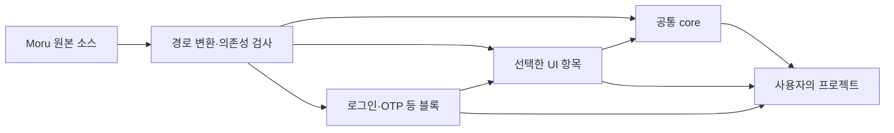

# Moru 선택 설치 레지스트리 설계안

Moru의 컴포넌트 소스를 필요한 만큼 가져와 직접 수정하는 배포 방식입니다.
공개 소스는 MIT 라이선스를 기준으로 준비하고, 제3자 코드·아이콘·폰트의 고지는 유지합니다.

**현재는 레지스트리를 구현하거나 설치 가능한 항목을 배포한 상태가 아닙니다.**
공개 소스 저장소는 [syrus-riius/moru-ui](https://github.com/syrus-riius/moru-ui)입니다.
이 문서의 경로와 명령은 구현 후 제공할 목표입니다. 현재 스타터 ZIP 다운로드와는 별개입니다.

## 1. 첫 배포는 공개 GitHub 저장소에서

저장소 루트에 `registry.json`을 두고 공유할 파일과 의존성을 선언합니다.
현재 shadcn CLI는 공개 GitHub 저장소를 직접 읽으므로 별도 설치 서버는 필요하지 않습니다.
필요한 항목을 받으면 사용자의 프로젝트에 소스 파일이 생기고, 사용자가 자유롭게 수정합니다.
이는 npm 패키지를 설치해 내부 구현을 import하는 방식과 다릅니다.

```sh
# 향후 목표 형식 — 아직 실행 가능한 설치 안내가 아닙니다.
# RELEASE_TAG는 실제 발행한 태그로 바꿔야 합니다.
npx shadcn@latest add syrus-riius/moru-ui/button#RELEASE_TAG
npx shadcn@latest add syrus-riius/moru-ui/login#RELEASE_TAG
```

`v0.3.0` 등의 태그는 실제 발행·검증하기 전까지 설치 예시로 안내하지 않습니다.
처음에는 GitHub 주소를 제공하고, 나중에 Moru 사이트의 `/r/` 주소와 `@moru` 별칭을 추가합니다.
근거: [GitHub 레지스트리 공식 문서](https://ui.shadcn.com/docs/registry/github).

## 2. 원본은 하나로 유지하기

갤러리·스타터·레지스트리의 컴포넌트를 따로 관리하면 수정 내용이 달라지기 쉽습니다.
현재 `src/components/ui`, `src/components/blocks`, `src/theme`을 원본으로 사용합니다.
생성 단계에서 설치 경로와 import만 바꾸고, 생성 파일은 직접 수정하지 않습니다.



원본 체크섬과 생성 결과를 검사해 오래된 레지스트리가 배포되지 않도록 합니다.

## 3. 설치 항목 나누기

| 항목 | 포함할 내용 |
| --- | --- |
| `core` | 공통 CSS·기본 토큰·읽기 보정, `cn`, 상태·필드 helper, 테마·portal 기반 |
| `button`, `input` 등 | 선택한 컴포넌트와 전용 CSS·helper, `core` 의존성 |
| `login`, `otp` 등 | 실제 블록 소스와 그 블록이 사용하는 Moru UI 의존성 |
| `fonts` | 선택 설치할 Pretendard·Noto Sans CSS와 의존성·고지 |

예를 들어 로그인은 Button·Input·PasswordInput·Field·Checkbox·Card를 함께 가져옵니다.
사용하지 않는 차트·표·캐러셀의 소스나 npm 의존성은 설치하지 않습니다.
Base UI는 `@base-ui/react`라는 패키지명으로 선언합니다. `/button`은 import 하위 경로입니다.

**공통 CSS는 첫 버전에서 함께 설치됩니다.** 현재 `styles.css`가 여러 UI의 규칙을 공유하고,
`form-controls.css`·`feedback.css`를 import하므로 Button의 TSX만 복사하면 디자인이 완성되지 않습니다.
처음에는 선택적 소스 설치를 제공하고, 컴포넌트별 CSS 분리는 이후 단계로 진행합니다.
공통 스타일은 한 번 연결하고, 기존 앱의 전역 스타일과 사용자가 수정한 토큰을 보존해야 합니다.

## 4. 기존 컴포넌트와 경로가 겹치지 않게

설치 대상은 사용자의 `components.json`에 있는 UI 경로 아래 `moru/`로 모읍니다.
`@ui/`는 설치 경로를 뜻하는 공식 placeholder이며 사용자의 import 별칭과는 별개입니다.

```text
<사용자의 UI 경로>/moru/
  button.tsx
  input.tsx
  styles.css
  _lib/cn.ts
  _theme/tokens.ts
  blocks/LoginBlock.tsx
```

생성 시 Button의 `../../lib/cn`은 `./_lib/cn`으로 바꿉니다.
블록의 `../ui/button`은 `../button`으로 바꾸고, 전용 CSS는 연결된 파일과 함께 둡니다.
대상 예시는 `@ui/moru/button.tsx`입니다. 사용자의 기존 `button.tsx`를 덮어쓰지 않습니다.
근거: [항목 스키마와 대상 경로](https://ui.shadcn.com/docs/registry/registry-item-json).

## 5. Moru 의존성을 정확히 가리키기

`registryDependencies: ["button"]`은 Moru가 아니라 **shadcn 기본 Button**을 뜻합니다.
GitHub 방식에서는 `syrus-riius/moru-ui/button#RELEASE_TAG`처럼 전체 주소를 지정합니다.
각 의존성에도 실제 태그를 고정해야 같은 버전을 재현할 수 있습니다.

```json
{
  "name": "button",
  "type": "registry:ui",
  "dependencies": ["@base-ui/react@1.9.0"],
  "registryDependencies": ["syrus-riius/moru-ui/core#RELEASE_TAG"],
  "files": [{
    "path": "registry/moru/button.tsx",
    "type": "registry:ui",
    "target": "@ui/moru/button.tsx"
  }]
}
```

이 JSON은 구조 예시이며 해당 생성 경로·태그·항목은 아직 없습니다.
근거: [레지스트리 의존성 규칙](https://ui.shadcn.com/docs/registry/registry-item-json).

## 6. 구현과 검증 순서

1. `core`와 Button·Input·Field·Card·Checkbox·PasswordInput·InputOTP를 구성합니다.
2. 로그인·OTP 블록을 연결하고 깨끗한 Vite·React·TypeScript·Tailwind 4 프로젝트에 설치합니다.
3. Select·Switch·Badge를 추가해 검색 필터·설정 폼까지 검증합니다.
4. Calendar·DatePicker·오버레이처럼 의존성이 많은 항목으로 범위를 넓힙니다.

실제 CLI 설치, TypeScript·앱 빌드, 다른 alias, 기존 shadcn과의 공존을 확인합니다.
추가 설치 시 core 중복, 수정 파일 덮어쓰기, CSS 순서, 한글 경로도 확인합니다.
라이트·다크·모바일, 키보드·오류·로딩, 중첩 팝업의 포커스와 테마까지 점검합니다.
Next.js의 `use client`, SSR·hydration은 현재 미검증이므로 통과 전까지 지원을 약속하지 않습니다.
React Native·Expo는 DOM·CSS를 쓰지 않아 별도 설치 항목과 검증 경로가 필요합니다.

안정화 후 같은 항목을 `public/r/registry.json`, `public/r/button.json` 등으로 생성할 수 있습니다.
현재 Moru 사이트에서 정적으로 제공하고 `@moru` namespace를 연결하는 방식입니다.
근거: [정적 빌드·호스팅과 설치 검증](https://ui.shadcn.com/docs/registry/getting-started),
[레지스트리 목록 스키마](https://ui.shadcn.com/docs/registry/registry-json).
