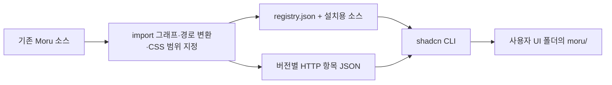

# Moru 레지스트리 구현과 확장 계획

v0.3.1에서 공통 기반·Button·Input·Field·로그인·OTP의 선택 설치를 구현했습니다.
실제 설치와 테마 연결은 [사용 가이드](registry.ko.md)를 참고하세요.
공개 소스는 [syrus-riius/moru-ui](https://github.com/syrus-riius/moru-ui)에 있습니다.

## 원본 하나에서 두 경로로 배포

`scripts/build-registry.mjs`가 실제 import를 AST로 읽고 전용 CSS까지 재귀 수집합니다.
갤러리·스타터·레지스트리를 위해 컴포넌트를 따로 손으로 수정하지 않습니다.
설치용 소스는 `registry/moru/`, HTTP 항목은 `public/r/v0.3.1/`에 생성합니다.
`registry:check`는 소스 체크섬과 생성된 파일 내용이 일치하는지 검사합니다.

## 설치 단위

| 항목 | 포함 범위 |
| --- | --- |
| core | 공통 CSS·토큰·간격·테마·portal·도우미·MIT 고지 |
| button, input, field | 해당 소스와 core |
| login | 기존 LoginBlock과 Button·Input·Field·Card·Checkbox·PasswordInput 등 실제 의존성 |
| otp | 기존 OTPBlock과 Button·Field·Card·InputOTP 등 실제 의존성 |
| 보조 항목 | 블록에 필요한 Card·Checkbox·PasswordInput·InputOTP·StatusMessage도 개별 항목으로 제공 |

차트·표·캐러셀은 이 설치 범위에 포함하지 않습니다. 폰트도 자동 다운로드하지 않습니다.
공통 CSS는 첫 버전에서 함께 설치하며, 선택한 컴포넌트 소스와 전용 CSS는 분리합니다.

## 기존 앱과 함께 사용하기

- 설치 대상은 `@ui/moru/`로 선언해 사용자의 UI 별칭을 따릅니다.
- 원본의 상대 import는 설치 구조에 맞춰 변환하며 `.ts` 확장자 의존성을 제거합니다.
- `MoruProvider`가 해당 영역에만 토큰을 적용합니다. `default.css`의 전역 `:root`는 가져오지 않습니다.
- 공통 CSS는 Moru scope와 portal 내부로 제한하고 animation 이름도 구분합니다.
- 클라이언트 경계가 필요한 생성 파일에는 `use client`를 표시합니다.
- MIT 원문과 재배포 안내를 core의 `_licenses/`에 함께 설치합니다.

## 버전과 의존성

HTTP 의존성은 `https://moru-ui-lab.riius.chatgpt.site/r/v0.3.1/core.json`처럼
버전 경로 전체를 사용합니다. GitHub 의존성도 `syrus-riius/moru-ui/core#v0.3.1`처럼 고정합니다.
단순히 `"button"`을 적으면 shadcn 기본 Button을 가리키므로 Moru 의존성에는 사용하지 않습니다.
새 릴리스는 새 경로와 태그를 발행하며 이전 HTTP 버전 폴더는 유지합니다.

## 검증 경로

`npm run registry:smoke`는 실제 shadcn CLI로 독립적인 새 React 프로젝트를 생성합니다.
기본 모드에서는 공개 항목을 임시 localhost에서 제공하며 Moru 의존성의 주소만 local로 변환합니다.
`--base-url https://moru-ui-lab.riius.chatgpt.site/r/v0.3.1` 모드는 배포된 JSON을 그대로 사용합니다.
기존 버튼 보존, 수정한 공통 파일 보존, 별칭·한글·공백 경로, 필요한 의존성만 설치되는지와
TypeScript·프로덕션 빌드를 확인합니다. 화면·키보드·폼 동작은 설치된 소비자 앱에서 별도로 점검합니다.

## 다음 범위

검색 필터·설정 블록, Select·Switch·Badge, Calendar·DatePicker·오버레이 순으로 넓힙니다.
웹폰트 선택 설치와 더 작은 CSS 분리도 후속 범위입니다.
현재 검증 기준은 Vite·React·TypeScript·Tailwind CSS 4입니다.
Next.js SSR·hydration, React Native·Expo 설치는 이 릴리스에 포함하지 않습니다.

공식 규격: [GitHub 레지스트리](https://ui.shadcn.com/docs/registry/github),
[항목·의존성·대상 경로](https://ui.shadcn.com/docs/registry/registry-item-json),
[정적 레지스트리](https://ui.shadcn.com/docs/registry/getting-started).
